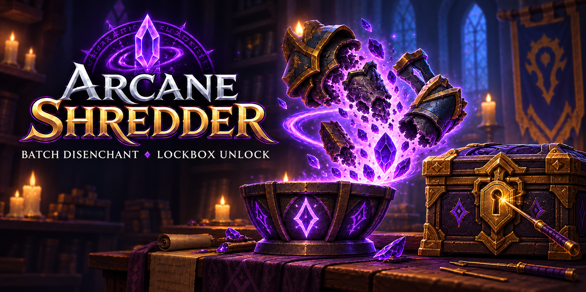

# Arcane Shredder UI



Companion addon for [mod-arcane-shredder](https://github.com/eveletspb/mod-arcane-shredder), providing safe batch disenchanting and lockbox unlocking for WoW WotLK 3.3.5a.

The addon requests a server-generated preview, displays every selected item, lets you exclude individual items, and requires an explicit confirmation. The server remains authoritative and validates every item again before processing it.

## Requirements

- WoW WotLK 3.3.5a (`Interface 30300`).
- A server running a compatible version of `mod-arcane-shredder`.
- The addon and server module must both support ASHRED protocol version `2`.
- Disenchanting requires Disenchant and the required Enchanting skill. Lockbox unlocking requires Pick Lock and sufficient Lockpicking skill.

## Required addon folder name

The installed addon folder **must be named exactly**:

```text
ArcaneShredderUI
```

The repository name (`arcane-sheredder-ui`) is not the in-game addon folder name. After installation, this exact file must exist:

```text
World of Warcraft/Interface/AddOns/ArcaneShredderUI/ArcaneShredderUI.toc
```

Avoid an extra nested directory such as:

```text
Interface/AddOns/ArcaneShredderUI/ArcaneShredderUI/ArcaneShredderUI.toc
```

## Installation

1. Download or clone this repository.
2. Copy the inner `ArcaneShredderUI` directory into `World of Warcraft/Interface/AddOns/`.
3. Confirm that the resulting directory layout is:

   ```text
   Interface/
   └── AddOns/
       └── ArcaneShredderUI/
           ├── ArcaneShredderUI.toc
           ├── ArcaneShredderUI_Locales.lua
           └── ArcaneShredderUI.lua
   ```

4. Restart the WoW client if it was running.
5. Enable **Arcane Shredder** in the AddOns list on the character-selection screen.

## Usage

1. Open the addon with:

   ```text
   /ashred
   ```

2. Choose **Disenchant** or **Unlock lockboxes**, then configure the filters:

   - **Quality:** Uncommon, Rare, and/or Epic (Disenchant tab only).
   - **Binding:** unbound and/or soulbound items.
   - **Bags:** backpack and any of the four equipped bags.
   - **Max item level:** `0` disables the client-side item-level limit (Disenchant tab only).
   - **Safe defaults:** restores Uncommon only, both binding types, all bags, and no client-side item-level limit.

3. Click **Preview**. The list is created by the server, not by the addon.
4. Review every item in the list. Hover over a row to see the standard item tooltip.
5. Click **Exclude** beside any item that should not be processed.
6. Check the remaining item count and preview expiration timer.
7. Click **Disenchant: N** or **Unlock: N** and accept the confirmation dialog, or click **Cancel preview** to discard the snapshot.

Filters and tabs are locked while a server preview is active. Cancel the current preview before switching modes. Unlocking only removes the lock; the lockbox and its contents stay in your bags for normal opening later.

### Unlock lockboxes in a batch

On the **Unlock lockboxes** tab, select the bags and binding types to scan, then
request a preview. The server lists only locked lockboxes that the character can
unlock with the known **Pick Lock** spell and current **Lockpicking** skill.
Exclude any boxes you want to leave locked, then confirm the batch.

The server checks each lockbox again before removing its lock. It does **not**
open the box, generate loot, remove the item, or move its contents. Open the
unlocked boxes normally afterward. Already unlocked boxes are not included in
a new preview.

## Safety model

- Only the backpack and contents of the four equipped bags are scanned.
- Equipped gear, bank, keyring, buyback, trade, mail, auction, and guild-bank items are outside the scan scope.
- The addon cannot expand the server policy. Server configuration always takes precedence over client filters.
- Preview tokens are short-lived, owner-bound, and single-use.
- The server resolves every item again by GUID and repeats all eligibility checks before changing it.
- Items moved, equipped, traded, changed, or removed after preview are skipped.
- Disenchant results use the server's normal loot templates. Exact materials are intentionally not pre-rolled during preview. Unlocking does not generate or collect loot.

## Status and protocol

Addon-to-server communication uses the hidden AzerothCore addon-message transport through `SendAddonMessage` and `CHAT_MSG_ADDON` with the `AzerothCore` prefix. The prefix registration call is guarded because stock WotLK 3.3.5a predates `RegisterAddonMessagePrefix`; newer clients use it when available. Uncached item information is refreshed through a bounded `OnUpdate` poll instead of relying on a later-client event.

Visible chat is not used as the machine protocol. It remains available only for help, diagnostic status, and normal system messages. Server diagnostics can be requested with:

```text
.ashred status
```

## Troubleshooting

### The addon does not appear in the AddOns list

- Verify that the folder is named `ArcaneShredderUI` exactly.
- Verify that `ArcaneShredderUI.toc` is directly inside that folder.
- Remove any accidental extra nesting created while extracting the archive.
- Confirm that you are running a WotLK 3.3.5a client.

### The window does not open

- Run `/ashred` without a leading dot.
- Confirm that the addon is enabled for the current character.
- Reload the UI with `/reload` and check for Lua errors.

### The addon reports that the server transport is unavailable

- Confirm that `mod-arcane-shredder` is installed and enabled on the server.
- Run `.ashred status` for server-side diagnostics.
- Confirm that the AzerothCore addon channel is enabled and that the server and addon use compatible protocol versions.

### Preview returns no items

- Select at least one binding type and one bag. The Disenchant tab also needs a quality.
- For disenchanting, check Enchanting and Disenchant. For lockboxes, check Pick Lock and the Lockpicking skill required by the lock.
- On the lockbox tab, only still-locked boxes appear; already unlocked boxes remain in your bags but are not shown.
- Server policy may reject refundable, temporarily tradeable, enchanted, socketed, protected, or high-item-level items.

### Preview remains on “Waiting for the server preview”

- Verify that the AddOns list reports Arcane Shredder version `1.0.3` or newer, then run `/reload`.
- A sent request must either complete or show a timeout within five seconds. An indefinite loading state means an older addon copy is still installed.
- If the problem persists, run `/console scriptErrors 1`, reload the UI, and capture the first Lua error.

## Development checks

From the repository root:

```bash
python3 -m unittest discover -s tests -p 'test_*.py'
luac -p ArcaneShredderUI/ArcaneShredderUI_Locales.lua ArcaneShredderUI/ArcaneShredderUI.lua
```
